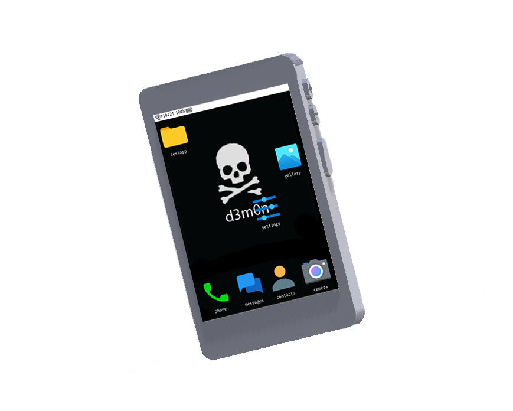
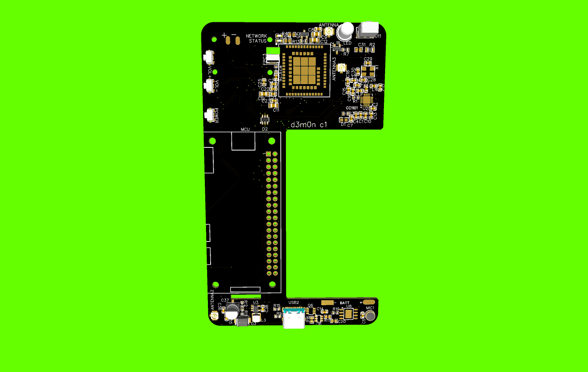

#  d3m0n_c1

<h3 align="center">The first open-source hacking phone.</h3>

<p align="center">
  <b>Developed by 4RE5 Group · © 2026</b>
  <br><br>
  
  
  
</p>

<p align="center">
  
</p>

<p align="center">
  <i>Hack in your pocket. Hack from everywhere.</i>
</p>

---

> [!WARNING]
> **The project is currently under active development.**
>
> We decided to rebuild the d3m0n operating system from scratch in C to improve performance, memory management and low-level hardware control.
>
> The software is currently in beta testing, and some features described below may not yet be fully implemented or validated on the physical device.

## 📖 About d3m0n_c1

**d3m0n_c1** is an open-source, multifunctional mobile device designed for hardware experimentation, wireless security research, penetration testing and privacy-oriented computing.

Unlike conventional smartphones, d3m0n is being developed as an extensible hardware and software platform.

The project combines:
- A custom open-source operating system.
- Wireless communication and RF experimentation.
- USB hardware interaction.
- Infrared signal experimentation.
- Cellular connectivity.
- A dedicated application ecosystem.
- Hardware designed to be modified and extended.

The idea is to bring multiple hardware experimentation tools together in one portable device.

Our philosophy is simple:

**Your hardware. Your software. Your control.**

## 🖥️ d3m0n OS

[](https://github.com/d3m0n-project/d3m0n_os)

d3m0n_c1 runs **[d3m0n OS](https://github.com/d3m0n-project/d3m0n_os)**, the official operating system developed specifically for d3m0n devices.

The operating system is designed around a lightweight, customizable software environment with its own application architecture.

### Main software components

| Component | Description |
|---|---|
| Core system | Custom firmware developed in C |
| Application system | Dedicated d3m0n application ecosystem |
| Configuration | Centralized `/config` file |
| Wallpapers | Customizable system wallpapers |
| Compiler | Application compilation infrastructure |
| SDK | Documentation and development interfaces |
| Debugging | Simulation, GDB and memory tracking options |

### ⚙️ Customization

d3m0n OS provides a configuration file located at the root of the system disk:

`/config`

It can be used to customize aspects of the system, including:
- Icons.
- Themes.
- Wallpapers.
- Desktop applications.
- System appearance and behaviour.

Wallpapers are stored in:

`/rootfs/wallpapers`

### 📦 Application ecosystem

One of the main goals of d3m0n OS is to make application development accessible.

The system includes a dedicated application structure and `.d3m0n` application examples.

Developers can explore:
- Application templates.
- Application compilation.
- Application layouts.
- The App Studio interface.

Useful resources:

- [d3m0n OS repository](https://github.com/d3m0n-project/d3m0n_os)
- [SDK documentation](https://d3m0n.4re5.com/d3m0n_os/)
- [Application examples](https://github.com/d3m0n-project/d3m0n_os/tree/main/rootfs/usr/share/applications)

### 🛠️ Building d3m0n OS

The firmware can be built from source on a Linux development machine.

```bash
git clone --recurse-submodules https://github.com/d3m0n-project/d3m0n_os.git

cd d3m0n_os

make export
```

The project also provides several build and debugging options:

| Variable | Default | Purpose |
|---|---:|---|
| `DEBUG` | 0 | Enable simulation mode |
| `DEBUG_OUTLINE` | 0 | Display control outlines |
| `USE_ADMIN` | 1 | Control administrative privileges |
| `SHOW_IMAGE_STATUS` | 0 | Display loaded image information |
| `TRACK_MEMORY_USAGE` | 0 | Track allocated heap memory |
| `USE_GDB` | 0 | Enable GDB debugging |
| `BUILD_APPS` | 1 | Build applications during disk creation |

For complete instructions, see the [official d3m0n OS README](https://github.com/d3m0n-project/d3m0n_os#readme).

---

## ⚡ Hardware Features

d3m0n_c1 is designed to combine several hardware interfaces into one portable platform.

### 📡 Wireless and RF experimentation

The device is designed for experimentation with wireless technologies and radio protocols.

Potential applications include:

- RF signal analysis.
- Compatible sub-GHz remote-control systems.
- Bluetooth experimentation.
- Wi-Fi security research.
- Wireless peripherals.
- Infrared communication.
- FM-related experimentation.

The supported frequency bands and protocols depend on the corresponding radio hardware.

### 🔌 USB and hardware interaction

- **1 × USB Type-C:** Charging and data transfer.

USB device emulation can be used for authorized security research, including BadUSB testing.

### 📶 Cellular connectivity

The device integrates an **A7682E LTE module**.

Intended functionality includes:
- SMS messaging.
- Voice calls.
- Cellular connectivity.

Actual network compatibility depends on carrier support and regional LTE bands.

### 📺 Display

| Specification | Value |
|---|---|
| Technology | CTP |
| Resolution | 320 × 480 |
| Input | Touchscreen |

### 📷 Camera

- Rear-facing camera.
- Up to 1080p capability.

### 🔋 Battery

| Specification | Value |
|---|---|
| Type | Lithium-ion |
| Voltage | 3.7 V |
| Capacity | 3000 mAh |

Battery autonomy has not yet been tested.

---

## 📐 Physical Specifications

| Specification | Value |
|---|---|
| Width | 70 mm |
| Height | 120 mm |
| Weight | Approximately 250 g |
| Battery | 3000 mAh |
| Display | 320 × 480 CTP |

*Specifications may change during hardware development.*

---

## 🧪 Hardware Development

d3m0n is intended to be more than a closed consumer product.

Our long-term objective is to provide a platform that users can inspect, modify, repair and improve.

Future hardware revisions are expected to introduce:
- Dedicated hardware debugging pins.
- Additional development interfaces.
- Improved hardware documentation.
- More powerful processing capabilities.
- Expanded connectivity.
- Custom motherboard development.

We also plan to investigate the possibility of designing our own motherboard from scratch using ARM-based processors.

---

## 🗺️ Development Roadmap

The project is actively evolving.

### Software
- [x] Dedicated operating system repository.
- [x] Custom configuration system.
- [x] Application ecosystem.
- [x] Application development tools.
- [ ] Complete C-based firmware rewrite.
- [ ] Improved stability.
- [ ] Further performance optimization.
- [ ] Expanded SDK documentation.

### Hardware
- [x] Initial d3m0n_c1 hardware design.
- [ ] Improved battery autonomy.
- [ ] Better processor performance.
- [ ] Increased RAM.
- [ ] Front-facing camera.
- [ ] Thinner and more refined enclosure.
- [ ] Additional debugging interfaces.
- [ ] Custom motherboard designed from scratch.

*Checkboxes reflect the project roadmap, not a guarantee of completion.*

---

## 🧊 3D Preview

<p align="center">
  
  <br>
  <i>Hardware preview — development model.</i>
</p>

PCB development and hardware visualization:

<p align="center">
  
</p>

Additional 3D models and manufacturing files will be documented as they become available.

---

## 🌐 Official Resources

| Resource | Link |
|---|---|
| Main website | [d3m0n.4re5.com](https://d3m0n.4re5.com/) |
| d3m0n_c1 repository | [GitHub](https://github.com/d3m0n-project/d3m0n_c1) |
| d3m0n OS repository | [GitHub](https://github.com/d3m0n-project/d3m0n_os) |
| SDK documentation | [Documentation](https://d3m0n.4re5.com/d3m0n_os/) |
| Discord | [Join the community](https://discord.com/invite/Rfb5ajz7cM) |
| Reddit | [r/d3m0nproject](https://www.reddit.com/r/d3m0nproject/) |

---

## ⭐ Support the Project

d3m0n is an independent open-source hardware and software initiative.

If you like what we're building:
- Star the repositories.
- Report bugs.
- Suggest improvements.
- Experiment with d3m0n OS.
- Develop applications.
- Contribute to the codebase.

Every contribution helps the project grow.

[](https://github.com/d3m0n-project/d3m0n_c1)

---

## ❤️ Special Thanks

Special thanks to [0xS4cha](https://github.com/0xS4cha) and [Arcanovax](https://github.com/Arcanovax) for their help with the project.

And thanks to everyone contributing to open-source hardware, software and security research.

---

<p align="center">
  <b>d3m0n_c1</b>
  <br>
  Open hardware. Open software. Complete control.
  <br><br>
  <b>4RE5 GROUP © 2026</b>
</p>
